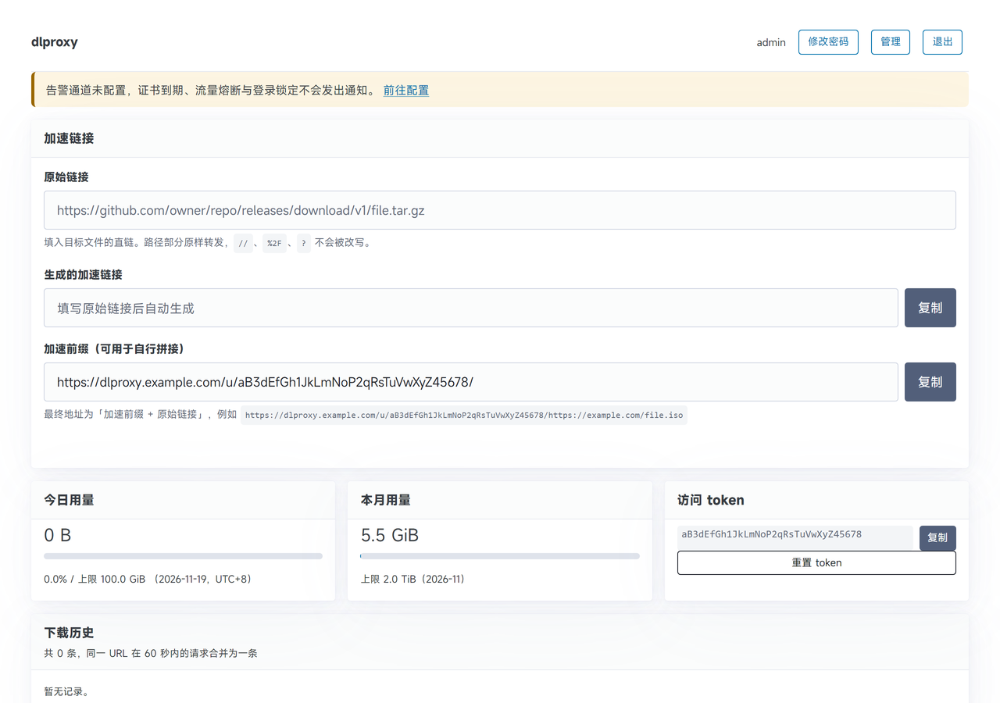
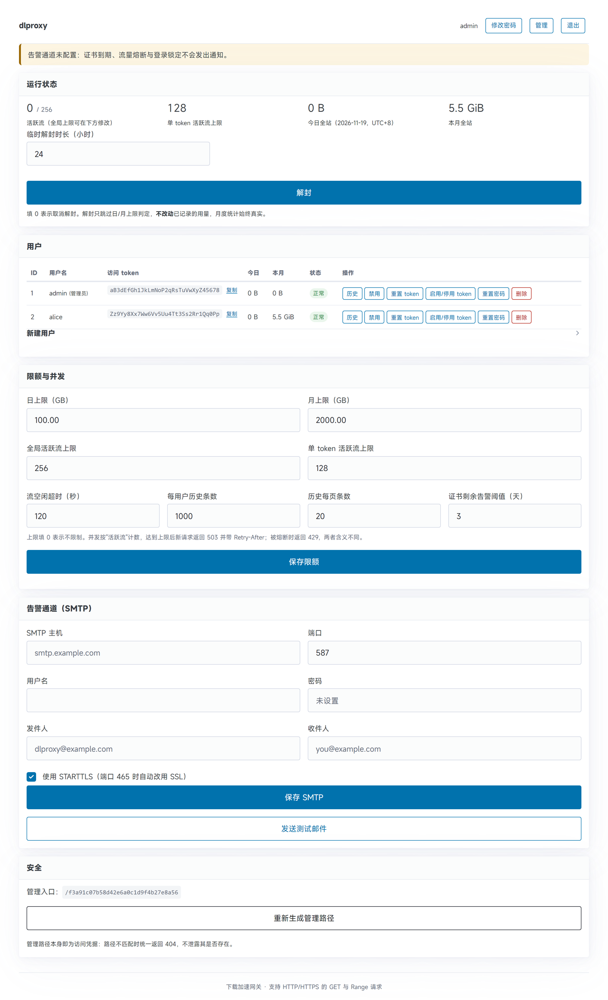

# dlproxy

**自托管的下载加速网关。** 给任意 HTTP(S) 直链套一个固定形状的链接，就能交给多线程下载器跑满服务器的出口带宽。

```
https://your-host/u/<token>/https://origin.example.com/big.iso
```

原始链接从请求路径**逐字节**还原，`//`、`%2F`、`?`、`&` 都不会被改写 —— 带签名的链接和 `git clone` 因此都能正常工作。少量账号手工创建，每人一个可重置的固定 token；只代理 `GET` / `HEAD` / `Range` 与 `git-upload-pack`。

<p align="center">
  
</p>

<p align="center">
  <sub>桌面端首页：链接即时生成，三处均可一键复制</sub>
</p>

## 特性

| | |
| --- | --- |
| **流式转发** | `GET` / `HEAD` / `Range` 逐块透传，不落盘、不缓冲整个响应体。40 GB 的文件只占几 KB 内存 |
| **`git clone` 可用** | 精确放行路径以 `/git-upload-pack` 结尾的 `POST`，`git push` 一律 403 |
| **双档流量熔断** | 日 / 月上限，超限返回 429；管理员可临时解封，解封期间不改动统计 |
| **并发闸门** | 全局与单 token 两级活跃流上限，打满返回 503 + `Retry-After` |
| **下载历史** | 按 60 秒窗口聚合，16 线程下载器的 16 个请求记为一行 |
| **强制 SSRF 防护** | 解析结果逐个校验 + 建连后 peer 复验（防 DNS rebinding），内网与云元数据地址一律 403，**无开关可关** |
| **凭据不进 URL** | 新 token / 新密码经服务端存储 + 短命 cookie 交接，不落在访问日志与浏览器历史里 |
| **443 可与他人共存** | 已被其他 TLS 服务占用时，按 SNI 分流共用 443，那个服务一行配置都不用改 |
| **安装向导** | `sudo ./install.sh` 把 7 个 flag 变成几个 y/n 问题，答完先打印命令再执行 |

## 快速开始

需要 Ubuntu 24.04（含 minimal aarch64）、root 或 sudo、公网 IPv4，并在云防火墙放行 **TCP 80 与 443**。

**全部操作都在服务器上完成**，不需要另一台机器中转：

```bash
# 1. 取代码（curl 是 base 必备，不用装 git）
curl -fL https://github.com/aL1CesT/dlproxy/archive/refs/heads/main.tar.gz | tar xz
cd dlproxy-main

# 2. 跑向导
sudo ./install.sh
```

也可以先装 git 再 clone（要 `git pull` 升级时用这条）：

```bash
sudo apt-get install -y git
git clone --depth 1 https://github.com/aL1CesT/dlproxy.git
cd dlproxy
sudo ./install.sh
```

两种方式都保留执行位（`install.sh`、`deploy.sh` 等 12 个脚本是 `0755`）。**别用 `curl … | bash`** —— 管道里脚本拿不到自己的目录，`deploy/install.sh` 就找不到了；先下载成文件再执行。

安装结束会打印站点地址、管理页完整 URL 与初始密码文件的位置：

```
  ── 后续步骤 ────────────────────────────────────────────

  1) 访问站点      https://203.0.113.9
  2) 管理页        https://203.0.113.9/8f3a1c6d94e2b70a5c8d13f6a9b4e072
  3) 初始账号文件  /opt/dlproxy/INITIAL_ADMIN.txt
     查看          sudo cat /opt/dlproxy/INITIAL_ADMIN.txt
     用完删除      sudo rm  /opt/dlproxy/INITIAL_ADMIN.txt
```

登录后第一件事是改密码、配 SMTP，然后删掉那个文件 —— 它在，页面就一直挂着黄色警告条。

不想用向导、想完全控制每个参数，就直接跑 `deploy.sh`：

```bash
sudo ./deploy.sh --stage all                # 六个阶段一次跑完
sudo ./deploy.sh --domain dl.example.com    # 用域名证书（约 90 天），否则默认 IP 证书（约 6 天）
```

装完之后源码目录可以删掉 —— 运行期只需要 `/opt/dlproxy`。之后要续跑某个阶段（比如换了域名重签证书），用装好的那一份：

```bash
sudo /opt/dlproxy/deploy/deploy.sh --stage cert --domain dl.example.com
```

## 用法

```bash
# 单线程
curl -O "https://<IP>/u/<token>/https://github.com/owner/repo/releases/download/v1/app.tar.gz"

# 16 线程
aria2c -x16 -s16 -k1M "https://<IP>/u/<token>/https://example.com/big.iso"

# 没有 aria2c 时（Debian minimal、容器里很常见），用仓库自带脚本，顺带校验 sha256
tools/range_download.sh "https://<IP>/u/<token>/https://example.com/big.iso" ./big.iso 16 <sha256>

# git clone
git clone "https://<IP>/u/<token>/https://github.com/owner/small-repo"
```

建号有三种等价方式：管理面板、`sudo dlproxy` 交互菜单、逐条命令（`python -m app createuser alice`）。

<p align="center">
  
</p>

## 文档

完整内容在 [`docs/`](docs/README.md)，按你当下要解决的问题分册：

| 想知道什么 | 看这里 |
| --- | --- |
| 服务器要准备什么、有域名和没域名的区别 | [deployment.md](docs/deployment.md) |
| 部署、建号、卸载的完整步骤与全部参数 | [deployment.md](docs/deployment.md#部署) |
| 443 已经被别的 TLS 服务占着怎么办 | [share-443.md](docs/share-443.md) |
| 证书为什么这么麻烦（IP 证书与域名证书不一样） | [certificates.md](docs/certificates.md) |
| 为什么 `proxy_pass` 不能带斜杠、SSRF 怎么防 | [design.md](docs/design.md) |
| 报错对照表 | [troubleshooting.md](docs/troubleshooting.md) |
| 用之前该知道的风险 | [limitations.md](docs/limitations.md) |
| 怎么跑测试、怎么改代码 | [CONTRIBUTING.md](CONTRIBUTING.md) |
| 每个文件的职责 | [layout.md](docs/layout.md) |

## 已知限制

用之前请先读 [docs/limitations.md](docs/limitations.md)。三条最要紧的：

- **证书是短命的。** 不用域名时是 IP 证书，有效期约 160 小时，续期失败一次就只剩几天缓冲；换公网 IP 证书立即失效。这是整套架构最脆的一环。
- **token 泄漏等于开放代理。** 代理任意外链、没有域名黑名单、token 长期固定，唯一处置手段是重置 token（旧链接立即 404）。
- **没有事前限速。** 单连接可以吃满实例出口带宽。熔断是事后兜底，并发上限是唯一的闸门。

## 环境与依赖

Python 3.12 + FastAPI + nginx，7 个直接依赖全部是纯 Python 包，aarch64 上无需编译器（`requirements.txt` 只钉直接依赖，不冻结传递依赖 —— 在 x86 上冻结出来的 wheel tag 到 arm64 会找不到）。前端是服务端渲染的 Jinja2 模板加一份 vendored 的 Pico.css，不走 CDN。

## 许可

[MIT](LICENSE)。变更记录在 [CHANGELOG.md](CHANGELOG.md)，安全问题请按 [SECURITY.md](SECURITY.md) 报告，参与开发见 [CONTRIBUTING.md](CONTRIBUTING.md)。
